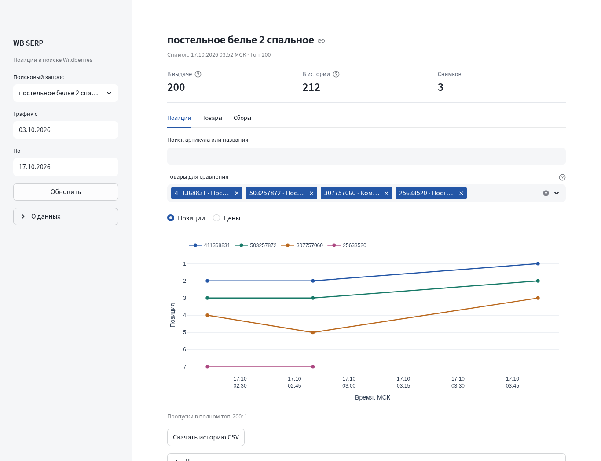
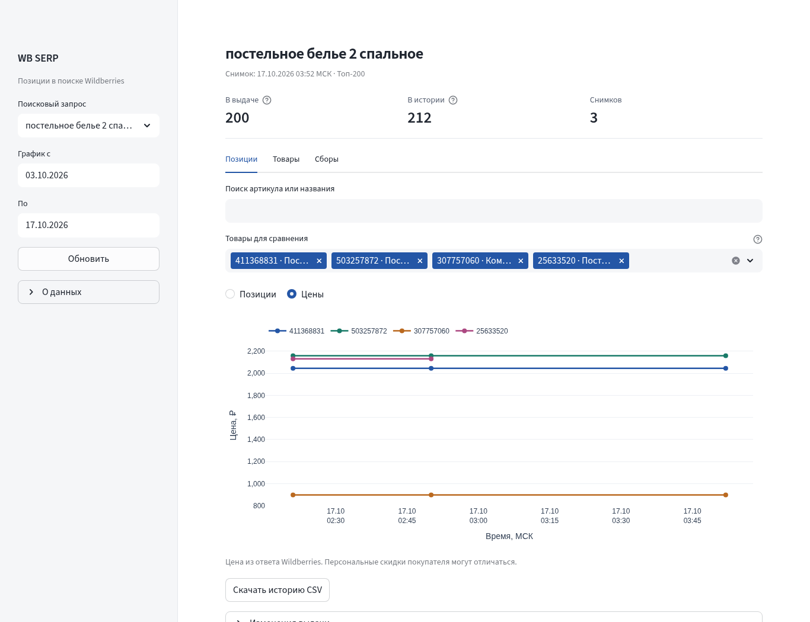
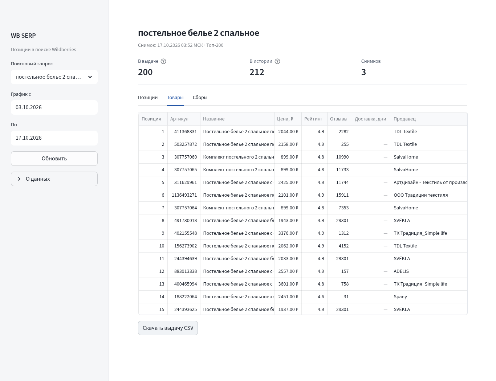
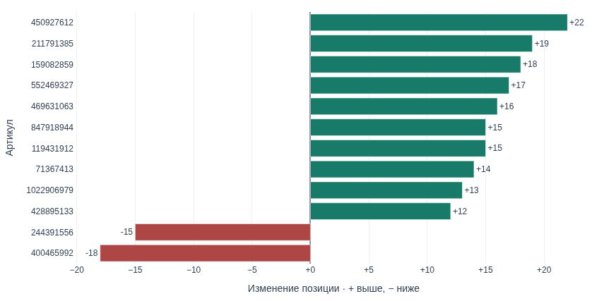
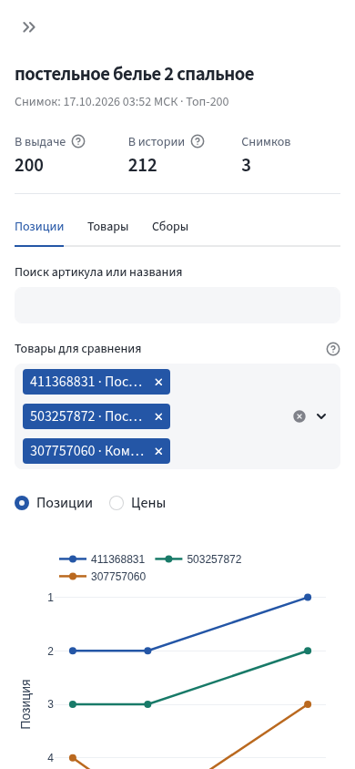

# WB SERP

[](https://github.com/Markinllz/wb-serp/actions/workflows/ci.yml)

История поисковых позиций Wildberries: 70 фраз, до 200 товаров по каждой, сбор раз в час. Python, SQLite, Streamlit и Plotly. Работает на одной VPS в Docker.

**[Открыть панель](https://wb.agentichub.ru)** · **[Мониторинг](https://wb.agentichub.ru/grafana/)** · [Архитектура](docs/ARCHITECTURE.md) · [Требования](docs/REQUIREMENTS.md)

Демонстрационная панель защищена паролем. Доступ передаётся отдельно.



## Что можно посмотреть

- Позиции и цены одного или нескольких артикулов за выбранный период.
- Последнюю выдачу: цена, рейтинг, отзывы, продавец и доступный срок доставки.
- Новые товары, выход из топа и изменение позиций между двумя полными снимками.
- Историю сборов, ошибки и неполные выдачи.
- CSV с товарами, характеристиками и историей наблюдений.

<details>
<summary>Цены, товары и изменения выдачи</summary>







</details>

<details>
<summary>Мобильный экран</summary>



</details>

## Запуск в Docker

Нужны Docker Engine и Compose v2. Для браузерного сборщика рекомендуется Linux с 2 vCPU и 4 ГБ RAM; мониторинг потребляет дополнительную память.

```bash
git clone https://github.com/Markinllz/wb-serp.git
cd wb-serp
cp .env.example .env
docker compose -f compose.yaml -f compose.browser.yaml up -d --build
```

Откройте **http://127.0.0.1:8501**. Первый сбор начинается при запуске, следующие — на границе часа. Сборщик использует собственный Chromium в контейнере; личный браузер не нужен.

```bash
docker compose -f compose.yaml -f compose.browser.yaml logs -f collector
bash scripts/smoke_vps.sh
```

История сохраняется в Docker volume `wb_data`. Команда `docker compose down -v` удаляет данные.

## Домен и HTTPS

Направьте A-запись своего домена на сервер и откройте порты 80/443. Создайте хеш пароля:

```bash
docker run --rm -it caddy:2.10-alpine caddy hash-password
```

Укажите в `.env` домен и полученный хеш. Одинарные кавычки защищают `$` от подстановки Compose:

```dotenv
APP_DOMAIN=serp.example.com
BASIC_AUTH_HASH='$2a$14$...'
```

```bash
docker compose -f compose.yaml -f compose.browser.yaml --profile public up -d --build
```

Caddy выпускает и продлевает сертификат. Имя пользователя — `analyst`. Порт приложения остаётся доступен только локально.

## Мониторинг

Prometheus собирает состояние сборов, свежесть данных, ошибки, CPU, память, диск и ресурсы контейнеров. Grafana показывает готовую панель; доступ — через тот же пароль по пути `/grafana/`.

Добавьте отдельный случайный `GRAFANA_ADMIN_PASSWORD` в `.env`, затем:

```bash
docker compose -f compose.yaml -f compose.browser.yaml -f compose.monitoring.yaml --profile public up -d --build
```

Порты Prometheus и экспортёров наружу не публикуются. Метрики хранятся семь дней с ограничением 1 ГБ. [Метрики и предупреждения](docs/MONITORING.md).


## Данные

Позиция — порядок товара в ответе WB. Полный снимок содержит ровно `WB_TOP_N` уникальных артикулов. Если источник возвращает меньше товаров, сохраняется неполный снимок; недостающие товары не добавляются. При дублях между страницами весь снимок повторяется один раз. При блокировке цикл прекращается.

Цена хранится в копейках. Время в базе — UTC, в панели — Москва. Недоступные поля остаются пустыми. Отсутствующая позиция прерывает линию графика. Сравнение всей выдачи использует только полные снимки.

Регион по умолчанию — фиксированная точка в Москве (`dest=1259570991`), подтверждённая геосервисом WB. Регион истории после начала сбора менять нельзя. Цена источника может отличаться от персональной цены на сайте; дата доставки в текущем ответе WB отсутствует.

У фразы `постельное белье евро вареный хлопок dr. hygge` WB возвращает меньше 200 товаров. Поэтому строгий результат 70 × 200 не заявляется. Доступность внутреннего поиска и состав выдачи зависят от WB.

## Резервная копия

```bash
docker compose exec -T dashboard python scripts/backup.py /app/data/backup-manual.sqlite
docker compose cp dashboard:/app/data/backup-manual.sqlite ./backup-manual.sqlite
```

Для ежедневной копии на Linux установите файлы из `deploy/`:

```bash
sudo install -m 0750 deploy/wb-serp-backup /usr/local/sbin/wb-serp-backup
sudo install -m 0644 deploy/wb-serp-backup.{service,timer} /etc/systemd/system/
sudo systemctl daemon-reload
sudo systemctl enable --now wb-serp-backup.timer
sudo systemctl start wb-serp-backup.service
```

Копия создаётся через SQLite Online Backup API, проверяется и сжимается. Расписание — около 03:15 по Москве, хранение — семь дней. Дополнительно храните копию вне сервера.

## Разработка и проверка

```bash
python3.12 -m venv .venv
source .venv/bin/activate
pip install -r requirements-dev.txt
python -m pytest
ruff check .
```

Проверка панели и CSV в Chromium:

```bash
docker compose exec -T dashboard python -m scripts.check_dashboard
```

Отдельный живой тест всех фраз, когда фоновый сборщик остановлен:

```bash
docker compose stop collector
bash scripts/test_live_full.sh --label manual
docker compose -f compose.yaml -f compose.browser.yaml up -d
```

Результаты сохраняются локально в `data/live-tests/`: код `0` означает 200 товаров для всех фраз, `2` — короткую выдачу или ошибку. Тесты на локальном HTTP-источнике не записывают искусственные наблюдения в рабочую историю.


