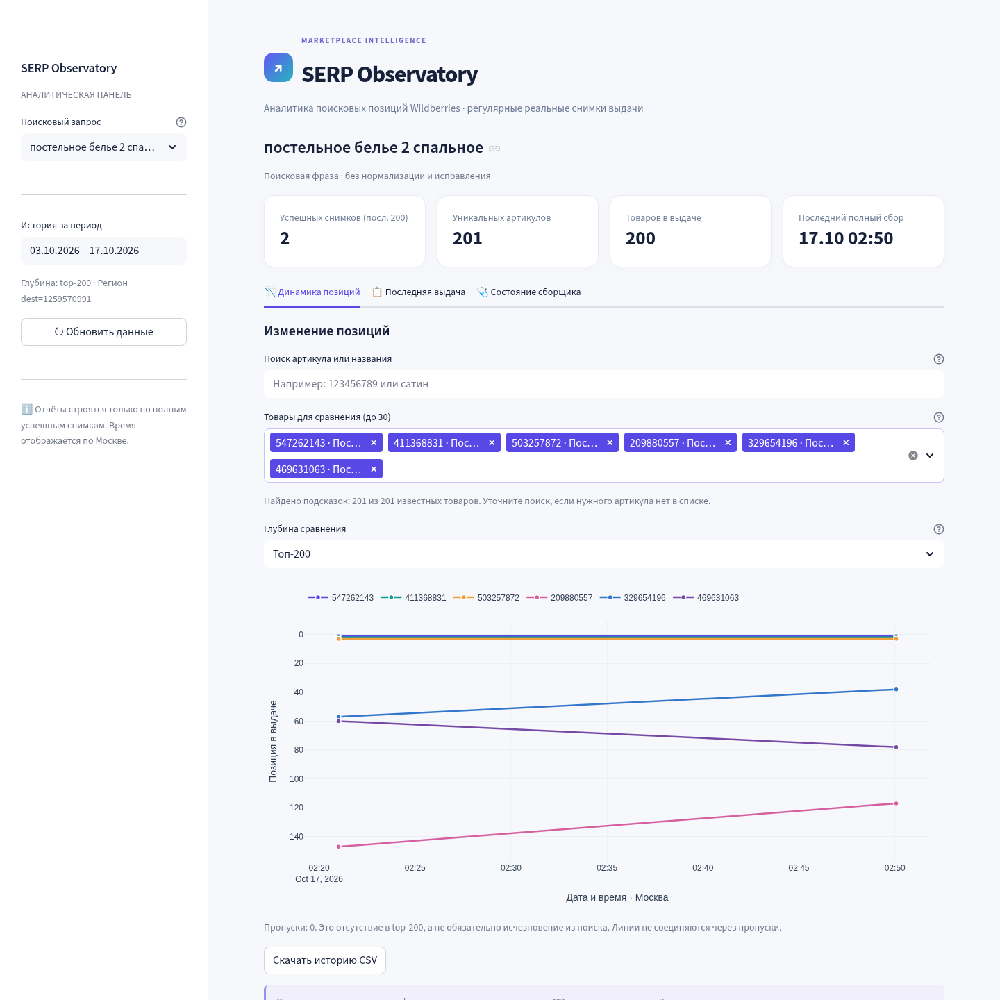

<div align="center">

# Wildberries SERP Observatory

История поисковых позиций Wildberries на одной VPS.

[](https://github.com/Markinllz/wb-serp/actions/workflows/ci.yml)


[Запуск](#запуск) · [Проверка](#проверка) · [Ограничения](#ограничения) · [Архитектура](docs/ARCHITECTURE.md)

</div>

Панель истории поисковых позиций Wildberries: 70 фиксированных фраз, сбор до 200 товаров по каждой фразе раз в час, SQLite и графики с выгрузкой CSV. Проект работает на одной VPS.



## Возможности

- Самостоятельный Chromium в Docker: браузерная сессия принадлежит сборщику.
- Настраиваемая глубина выдачи, фиксированный регион, история с датой и временем.
- Цена, рейтинг, отзывы, продавец и доставка; недоступные поля остаются пустыми.
- Сравнение артикулов по полным снимкам, фильтр периода и поиск по историческому каталогу.
- Журнал успешных, неполных, ошибочных и прерванных сборов.
- SQLite WAL, блокировка единственного писателя, резервное копирование и CSV.

**Результат живой проверки 17.10.2026:** после отдельной перепроверки двух ошибок — 69 фраз с top-200 и одна выдача из 114 товаров. Строгий результат 70 × 200 не подтверждён. [Протокол и исходные результаты](docs/LIVE_FULL_RESULT_2026-10-17.md).

## Запуск

Нужны Docker Engine и Docker Compose v2.

```bash
git clone https://github.com/Markinllz/wb-serp.git
cd wb-serp
cp .env.example .env
docker compose -f compose.yaml -f compose.browser.yaml up -d --build
docker compose -f compose.yaml -f compose.browser.yaml ps
```

Панель: **http://127.0.0.1:8501**. Сборщик использует собственный Chromium внутри Docker. Safari и импорт cookies для этого режима не нужны.

```bash
docker compose -f compose.yaml -f compose.browser.yaml logs -f collector
```

Первый сбор начинается при запуске, следующие — на границе часа UTC. По умолчанию выдерживается пауза 5 секунд между запросами и 5 секунд между фразами. Временные ошибки повторяются до трёх попыток с увеличением паузы и учётом `Retry-After`. При отказе доступа цикл останавливается.

Данные находятся в томе `wb_data`. Остановка и пересоздание контейнеров сохраняют историю. **`docker compose down -v` удаляет данные.**

## Проверка

Перед отдельным живым тестом остановите фоновый сборщик:

```bash
docker compose stop collector
bash scripts/test_live_full.sh --label manual
```

Сценарий проверяет все 70 фраз, сохраняет настоящие снимки в SQLite и отчёты в `data/live-tests/`. Код `0` означает полный top-200 по всем фразам; `2` — неполную выдачу или ошибку. При блокировке оставшиеся фразы отмечаются как невыполненные.

Одна фраза:

```bash
bash scripts/test_live_full.sh --label single --query 'постельное белье 2 спальное'
```

Проверка панели и CSV в Chromium контейнера:

```bash
docker compose exec -T dashboard python -m scripts.check_dashboard
```

После проверки возобновите регулярный сбор:

```bash
docker compose -f compose.yaml -f compose.browser.yaml up -d
```

Результаты и ограничения: [протокол проверки](docs/LIVE_FULL_RESULT_2026-10-17.md). Подробности живого теста: [инструкция](docs/AUTONOMOUS_LIVE_TEST.md).

## Данные и статусы

Позиция соответствует порядку товара в ответе источника. `success` означает ровно 200 уникальных артикулов. Дубли не удаляются со сдвигом рангов. Диагностический живой тест повторяет такой снимок один раз; штатный worker фиксирует ошибку и продолжает цикл.

Если источник сообщает меньше товаров, сохраняется `partial`. Частичные, прерванные и ошибочные снимки видны в журнале, но исключены из графиков. Отсутствие товара в полном снимке — пустое значение и разрыв линии.

Цена хранится в копейках, время — UTC с отображением по Москве. Недоступные характеристики сохраняются как `NULL`. Цена из ответа может отличаться от персональной цены покупателя. Срок доставки заполняется только при наличии явной даты.

Регион фиксируется при создании набора данных; смешивать регионы в одной истории нельзя. В текущей конфигурации `dest=1259570991`. Соответствие кода конкретному адресу доставки требует отдельной сверки на сайте.

В `config/queries.txt` сохранены 70 фраз приложения PDF. 17.10.2026 список дословно сверен с приоритетной Google-таблицей: все 70 строк совпадают. [Результат сверки](docs/verification_2026-10-17/requirements_query_list.json).

## Настройки

Настройки находятся в `.env`; браузерный режим задаётся `compose.browser.yaml`.

| Переменная | По умолчанию | Назначение |
|---|---|---|
| `WB_TOP_N` | `200` | Требуемая глубина полного снимка |
| `WB_DESTINATION` | `1259570991` в примере | Фиксированный регион |
| `WB_REQUEST_DELAY_SECONDS` | `5` | Минимальная пауза после запроса |
| `WB_QUERY_DELAY_SECONDS` | `5` | Пауза между фразами |
| `WB_REQUEST_RETRIES` | `3` | Максимальное число попыток запроса |
| `WB_RETRY_MAX_SECONDS` | `60` | Предельная пауза повторов |
| `WB_PAGE_LIMIT` | `15` | Максимальное число страниц |
| `WB_RUN_ON_STARTUP` | `true` | Сбор сразу после запуска worker |
| `WB_BROWSER_TIMEOUT_SECONDS` | `90` в браузерном режиме | Таймаут браузера |
| `WB_DB_PATH` | `/app/data/serp.db` в Docker | Путь к SQLite |

## Ограничения

- Внутренний поисковый интерфейс Wildberries может менять формат и правила доступа. Блокировка источника отражается в журнале.
- Для фразы `постельное белье евро вареный хлопок dr. hygge` источник в последней проверке сообщил `total=114`.
- Таблица товаров, каталог артикулов и графики сейчас используют полные успешные снимки. Товары короткой выдачи сохранены в SQLite, но их отдельное отображение в панели ещё не реализовано.
- Повтор всего снимка при дублях реализован в диагностическом сценарии; штатный worker фиксирует ошибку и продолжает цикл.
- Соответствие региона конкретному адресу доставки и персональной цены покупателя требует внешней сверки.
- Публичная демонстрационная версия пока не развёрнута.

## Доступ с VPS

Для приватного доступа:

```bash
ssh -L 8501:127.0.0.1:8501 ubuntu@YOUR_VPS_IP
```

Для публичного HTTPS направьте домен на VPS, откройте 80/443 и получите хеш пароля:

```bash
docker run --rm -it caddy:2.10-alpine caddy hash-password
```

Укажите `APP_DOMAIN` и `BASIC_AUTH_HASH` в `.env`. Хеш заключите в одинарные кавычки, чтобы Compose не подставлял `$`.

```bash
docker compose -f compose.yaml -f compose.browser.yaml --profile public up -d
```

Caddy выдаёт сертификат и защищает панель Basic Auth; имя пользователя — `analyst`. Без домена используйте SSH-туннель. Проверка публичного домена и TLS выполняется на целевой VPS.

## Резервная копия

```bash
docker compose exec -T dashboard python scripts/backup.py /app/data/backup-manual.sqlite
docker compose cp dashboard:/app/data/backup-manual.sqlite ./backup-manual.sqlite
```

Копия создаётся через SQLite Online Backup API. Храните отдельную копию вне VPS. При полной загрузке расчётный прирост составляет 336 000 наблюдений в сутки; следите за диском.

## Разработка

```bash
python3.12 -m venv .venv
source .venv/bin/activate
pip install -r requirements-dev.txt
python -m pytest
ruff check .
```

Браузерные зависимости сборщика: `requirements-browser.txt`. Тесты используют временные базы и локальные HTTP-источники; рабочая история ими не заполняется.

## Структура проекта

| Путь | Содержание |
|---|---|
| `wb_serp/` | Сборщик, браузерные транспорты, SQLite, графики и панель |
| `config/queries.txt` | 70 исходных поисковых фраз |
| `scripts/` | Живые проверки, проверка интерфейса и резервное копирование |
| `tests/` | Тесты парсинга, сети, хранения, планировщика и интерфейса |
| `docs/` | Архитектура, инструкции, протокол и артефакты проверок |
| `compose.browser.yaml` | Браузерный режим сборщика |
| `Caddyfile` | Публичный доступ через HTTPS и Basic Auth |

[Архитектура](docs/ARCHITECTURE.md): сборщик и панель работают раздельно; SQLite WAL обеспечивает чтение во время записи, межпроцессная блокировка допускает один сборщик.

В репозитории находятся исходники, пример конфигурации и результаты проверок на публичных данных WB. Локальные `.env`, базы, cookies и браузерные профили исключены из Git.
