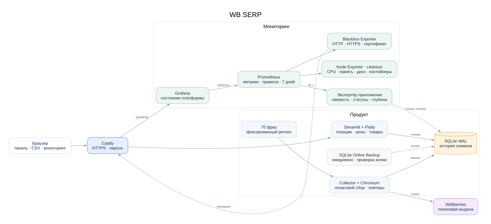

# Архитектура

Сборщик и веб-панель работают в отдельных контейнерах на одной VPS. Данные хранятся в SQLite на общем Docker volume; WAL допускает чтение во время записи.

```text
config/queries.txt → worker / CLI → Collector → SearchClient → Wildberries
                                       ↓
                                  SQLite WAL
                                       ↑
                           Streamlit → Plotly / CSV
```

## Компоненты

- `client.py` — пагинация, паузы, таймауты и ограниченные повторы.
- `cdp_transport.py` и `browser_transport.py` — Chromium, сессия и запросы из браузера. Профиль изолирован от личных браузеров; блокировка запрещает одновременное использование одного профиля.
- `parsing.py` — чтение и проверка полей карточки.
- `service.py` — сбор полного снимка и определение его статуса.
- `store.py` — схема SQLite, транзакции и запросы аналитики.
- `locking.py` — межпроцессная блокировка сборщика на общем volume.
- `cli.py` — ручной сбор и почасовой worker.
- `ui.py`, `charts.py` — панель, графики и экспорт. Панель открывает базу только для чтения и не запускает сбор.

`compose.browser.yaml` включает самостоятельный Chromium через CDP. Базовая конфигурация также поддерживает HTTPX и curl_cffi. Публичный доступ через Caddy включается профилем `public`.

## Сохранение снимка

Сначала создаётся запуск со статусом `running`. Страницы загружаются последовательно. Наблюдения и конечный статус записываются одной транзакцией. Межпроцессная блокировка сериализует ручные и фоновые сборы, включая разные контейнеры.

После перезапуска незавершённые запуски помечаются `interrupted`. Прежние снимки сохраняются. `WAL` и `synchronous=FULL` используются для надёжности записи; резервные копии создаются через SQLite Online Backup API.

## Правила данных

1. Ранг — место карточки в ответе источника, начиная с 1; самостоятельной сортировки нет.
2. `success` требует ровно `top_n` уникальных валидных артикулов. Повтор артикула считается ошибкой снимка.
3. Конец выдачи до нужной глубины даёт `partial`, отказ доступа — `blocked`, ошибка данных — `failed`.
4. В графики входят полные и неполные снимки одинаковой запрошенной глубины. `run_status` различает подтверждённое отсутствие в полном топе и неизвестную позицию при неполном сборе. `None` прерывает линию; наблюдаемая позиция неполного снимка отмечается ромбом.
5. Регион фиксируется в `dataset_settings`; смена региона после полного или неполного сбора с товарами запрещена.
6. Цена хранится в целых копейках, время — UTC. Отображение времени — Москва.
7. Недоступное поле остаётся `NULL`. Доставка рассчитывается только по явной календарной дате.
8. Формулировки запросов сохраняются буквально. `product_catalog` индексирует артикулы из полных и неполных снимков. Миграция схемы v2 → v3 дополняет индекс прежними неполными выдачами; исходные наблюдения и статусы не меняются.

## Ограничения

Поисковый интерфейс WB внутренний и может изменяться. Сессия восстанавливается ограниченным числом обычных загрузок поиска; CAPTCHA не решается. При временной ошибке соблюдается `Retry-After`, при блокировке цикл останавливается.

При дублях между страницами worker повторяет весь снимок один раз после паузы. Каждая попытка записывается отдельно; повторный дубль завершает сбор ошибкой. Блокировка и запрос остановки не запускают такой повтор.

Поисковые подсказки ограничены 250 результатами, сравнение — 30 артикулами. График показывает до 2200 снимков с предупреждением об усечении. История в SQLite автоматически не удаляется.

Графики позиций и цен используют одни и те же снимки и фильтры. CSV истории включает характеристики товаров; цена в нём остаётся в копейках. Сравнение выдачи использует два последних полных снимка выбранного периода и глубины; регионы должны совпадать. Разница рангов вычисляется только для общих артикулов, вход и выход из топа остаются категориями.

При 70 полных выдачах каждый час прирост составляет 336 000 наблюдений в сутки. Требуются контроль диска и отдельные резервные копии. Блокировка рассчитана на один Linux-хост и локальный Docker volume; несколько VPS и NFS не поддерживаются.

## Мониторинг



Отдельный экспортёр читает SQLite в режиме `mode=ro`. Он не запускает сбор и не делает запросы к WB. Prometheus собирает метрики приложения, Linux и контейнеров, а Blackbox Exporter проверяет HTTP и TLS. Grafana доступна через тот же Caddy по пути `/grafana/`. Конфигурации и экран находятся в `monitoring/`; публичных портов у экспортёров нет.
