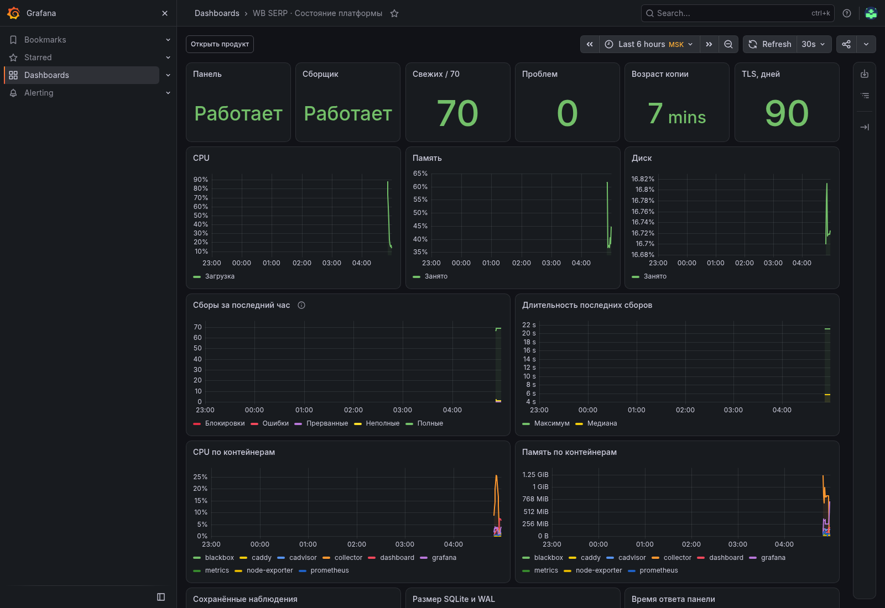

# Мониторинг

Один обзорный экран Grafana по пути `/grafana/`. На нём видны состояние панели и сборщика, свежесть всех 70 фраз, ошибки, возраст резервной копии, сертификат HTTPS, ресурсы сервера и контейнеров. Внизу — состояние последней попытки и число товаров по каждой фразе.



## Компоненты

| Сервис | Что измеряет |
|---|---|
| `metrics` | Читает SQLite: статусы, длительность, глубину, свежесть, объём истории |
| `node-exporter` | CPU, память, файловые системы Linux, время последней копии |
| `cadvisor` | CPU и память контейнеров проекта |
| `blackbox` | Ответ приложения, Grafana и публичного HTTPS; срок сертификата |
| `prometheus` | Собирает метрики каждые 30 секунд и проверяет правила |
| `grafana` | Показывает готовую панель из репозитория |

Экспортёр приложения открывает базу только для чтения и не обращается к WB. Полный и неполный снимки с товарами считаются свежими данными. Неполная выдача отдельно видна в статусах и числе товаров.

## Предупреждения

- Нет ответа сервиса или недоступна база: две минуты.
- Нет валидного снимка фразы больше двух часов: ещё десять минут ожидания.
- Новому или возобновлённому запросу даётся два часа на первый сбор. Время включения учитывается отдельно и не выдаётся за время настоящего снимка. Запросы на паузе не входят в проверку свежести.
- Блокировка WB: пять минут; ошибка или прерванный сбор: десять минут.
- На диске меньше 15%: пять минут; доступной памяти меньше 10%: десять минут.
- Нет подтверждённой резервной копии больше 26 часов.
- До истечения TLS-сертификата меньше 14 дней.
- Фоновый сборщик отсутствует больше десяти минут.

Состояния `pending` и `firing` отображаются в таблице предупреждений. Отправка уведомлений в Telegram или почту не включена.

## Доступ и хранение

Grafana доступна через Caddy и общий пароль панели. Caddy передаёт проверенное имя пользователя через auth proxy; внешний заголовок пользователя перезаписывается. В Grafana назначается роль Viewer, изменение готовой панели и самостоятельная регистрация отключены. `GRAFANA_ADMIN_PASSWORD` задаётся отдельно; его не нужно вводить при обычном просмотре.

Prometheus и экспортёры доступны только в Docker-сети. Метрики ограничены семью днями и 1 ГБ. Данные Grafana и Prometheus хранятся в отдельных томах. Linux-экспортёры используют системные каталоги хоста; запуск этого набора на Docker Desktop покажет ресурсы его Linux VM.

Изменения экрана вносятся в `monitoring/grafana/dashboards/overview.json`, правил — в `monitoring/alerts.yml`. Grafana перечитывает панель автоматически, Prometheus после изменения конфигурации перезапускается:

```bash
docker compose -f compose.yaml -f compose.browser.yaml -f compose.monitoring.yaml up -d --no-deps --force-recreate prometheus
```

Правила проверяются `promtool test rules /etc/prometheus/rules.test.yml` из каталога `/etc/prometheus` с примонтированной папкой `monitoring/`.

Конфигурация опирается на официальные инструкции [Prometheus](https://prometheus.io/docs/guides/node-exporter/), [Grafana provisioning](https://grafana.com/docs/grafana/latest/administration/provisioning/) и [cAdvisor](https://github.com/google/cadvisor/blob/master/docs/running.md).
